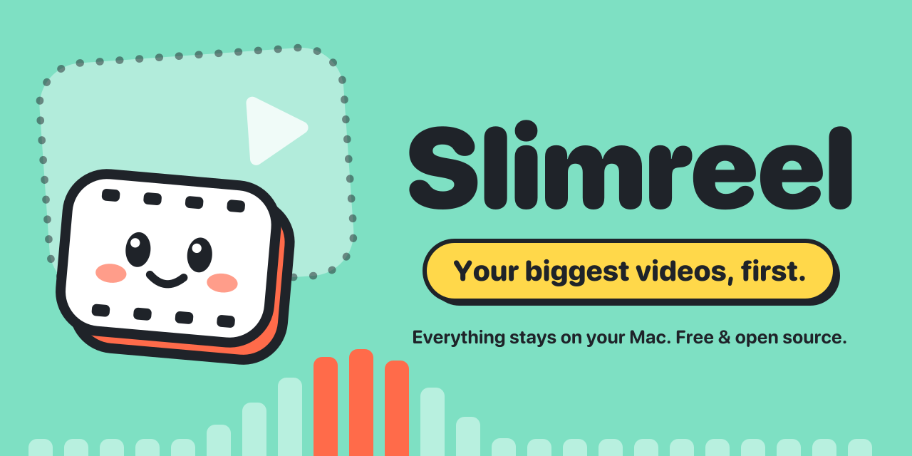

<p align="center">
  
</p>

<p align="center"><b>Find the big videos filling your iCloud, and get the space back without losing a thing.</b></p>

<p align="center">
  <a href="https://github.com/duggan/Slimreel/releases/latest/download/Slimreel.dmg"><b>⬇ Download Slimreel for Mac</b></a>
  ·
  <a href="https://duggan.github.io/Slimreel/">Website</a>
  ·
  <a href="https://github.com/duggan/Slimreel/releases">All releases</a>
</p>

<p align="center">Free and open source · macOS 14 or later</p>

<p align="center">
  <a href="https://github.com/duggan/Slimreel/actions/workflows/ci.yml"></a>
  <a href="https://github.com/duggan/Slimreel/releases/latest"></a>
  <a href="LICENSE"></a>
</p>

---

Your iCloud storage is nearly full, and most of it is videos. Photos can show you your
videos, but it can't sort them by size, so the few huge ones (a 4K clip shot at 120 fps
by accident, a forgotten screen recording) hide among the thousands of small ones.

Slimreel lists every video in your Photos library biggest first. Then you decide, one
video or a whole selection at a time: keep it, delete it, move the full original to a
folder or a NAS, or shrink it to a size that still looks fine on a phone.

## What it does

- **Biggest first.** Every video with its size, length, MB per minute, date and
  resolution, sortable by any column, with a preview player.
- **See when it piled up.** A size-by-month chart of your whole library. Drag across it
  to pick a date range, or use the presets: last 30 days, last 12 months, older than 1,
  3 or 5 years, or a single year. A minimum-size filter narrows it further.
- **Keep.** Mark a video as reviewed and hide it, so the list gets shorter as you go.
- **Move to Folder.** Saves the full original (and the edited version, if you edited
  it) to a folder, an external drive or a network share, checks each copy byte for byte,
  and only then removes the video from Photos.
- **Shrink.** Re-encodes a video to 1080p 60 fps (HEVC, keeps HDR) or 720p 30 fps, adds
  the smaller copy to Photos with the same date, location, favourite status and albums,
  then removes the original. A 72 MB 4K 120 fps clip became 8.9 MB.
- **Best of both.** Shrink can save the full-quality original to a folder first, so the
  small copy lives in iCloud and the original lives on your drive.
- **Delete.** Moves videos to Recently Deleted. Photos asks you first.

## Install

[Download Slimreel.dmg](https://github.com/duggan/Slimreel/releases/latest/download/Slimreel.dmg),
open it, and drag Slimreel to your Applications folder. It's signed and notarized by
Apple, runs on macOS 14 or later, and is a universal app for Apple silicon and Intel
Macs.

## How to use it

1. Open Slimreel and allow access to your Photos library when macOS asks.
2. Your videos appear biggest first. Pick a date range on the chart or set a minimum
   size to narrow the list.
3. Select one or more videos (the side panel previews a single one) and choose **Keep**
   (K), **Shrink**, **Move to Folder** or **Delete** (⌫) from the toolbar or the
   right-click menu.

### Shrink

Choose a resolution (1080p or 720p) and a frame rate (60 or 30 fps). Slimreel skips
slow-motion videos (they need their high frame rate), videos already within the limits,
and any that wouldn't come out at least 10% smaller. Edits are baked into the new copy.
Turn on **Save the full-quality originals to a folder first** to keep the originals on
a drive.

### Move to Folder

Pick a folder; Slimreel remembers it. It checks there's room first, works with network
shares, and never overwrites a file (a second copy becomes `IMG_1234 2.MOV`). Saved
files keep the video's original date.

### The timeline

The chart above the list shows how much space each month's videos take. It uses a
square-root scale so one huge month doesn't flatten the rest. Hover to see a month's
total and count; drag to select a range; the list and totals follow.

## Is it safe?

Nothing is removed until its copy has been checked byte for byte, and Photos asks you
before anything is deleted.

- **Move to Folder** compares every saved file's size with what Photos reports. If a
  copy fails or doesn't match, that video stays in Photos and the summary tells you why.
- **Shrink** checks the new copy plays and runs as long as the original before adding
  it, and adds it before removing anything. If you cancel Photos' delete prompt, you're
  left with both versions, not neither.
- **Deleted videos go to Recently Deleted** and stay there for 30 days, where you can
  recover them.
- **What Shrink doesn't keep:** the full resolution and frame rate (that's the point),
  extra audio tracks such as spatial audio (the main stereo track is kept), and the
  ability to undo edits. Use the archive option if you want the original too.

## Privacy

Everything stays on your Mac. Slimreel makes no network requests of its own and has no
account. The only permission it asks for is access to your Photos library, to list and
change your videos. When a video is only in iCloud, Photos downloads it as usual to
preview, move or shrink it.

## FAQ

**When does my iCloud space come back?** When Recently Deleted is emptied: by Photos
after 30 days, or straight away if you empty it yourself in Photos.

**Does Shrink lose quality?** Some, by design. 1080p HEVC at 60 fps looks the same on a
phone and most screens; you lose detail if you zoom into 4K footage. Archive the
original if that matters.

**What about slow-motion videos?** They're skipped by Shrink. Lowering their frame
rate would ruin the slow motion.

**Why not just use Photos?** Photos can't sort or filter videos by size, can't shrink
them, and can't move an original out of iCloud while checking the copy.

## Development

Needs Xcode 26 (the Swift 6 toolchain); the app targets macOS 14.

```sh
make run       # build, sign and launch
make test      # SlimreelKit unit tests (swift test)
make icons     # regenerate artwork (needs Inkscape)
make dmg       # signed DMG for local testing
make release   # notarized DMG (see docs/RELEASING.md)
```

Signing uses a Developer ID; override `SIGN_ID` in the Makefile for your own.

## Credits

iCloud, Photos and Mac are trademarks of Apple Inc. Slimreel is an independent project
and isn't affiliated with Apple.

## Licence

GPL-3.0. See [LICENSE](LICENSE).
